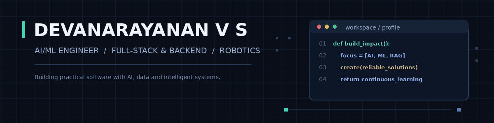

<!-- ───────────────────────── HEADER ───────────────────────── -->
<div align="center">



<br/><br/>

<a href="https://www.linkedin.com/in/devanarayanan-v-s-3878ab262"></a>
<a href="mailto:sskzm5780@gmail.com"></a>
<a href="https://www.instagram.com/thexcomrade"></a>


📍 Kerala, India &nbsp;•&nbsp; 🎓 B.Tech in AI &amp; ML (Minor: Robotics &amp; Automation) &nbsp;•&nbsp; 💼 Software Engineer Intern @ Stackup Learning

</div>


<!-- ───────────────────────── ABOUT ───────────────────────── -->
## 🧑‍💻 About Me

```python
class Devanarayanan:
    role       = ["AI/ML Engineer", "Full-Stack & Backend Engineer", "Robotics & Automation"]
    education  = "B.Tech AI & ML (2022-2026) | Minor: Robotics & Automation"
    location   = "Kerala, India"
    focus      = ["RAG & Generative AI", "Computer Vision", "AI for Healthcare", "Multimodal AI"]
    currently  = "Software Engineer Intern @ Stackup Learning (Next.js, TypeScript, FastAPI, RAG)"
    building   = "MediBridge AI - unified patient medical records"
    learning   = ["Vector databases", "Docker & deployment", "Evaluating RAG systems"]
    mission    = "Building AI solutions that create meaningful impact."
```


<!-- ───────────────────────── FOCUS ───────────────────────── -->
## 🎯 Current Focus

<table>
  <tr>
    <td align="center" width="20%">🤖<br/><b>AI &amp; ML</b><br/><sub>Model building &amp; evaluation</sub></td>
    <td align="center" width="20%">💬<br/><b>GenAI &amp; LLMs</b><br/><sub>RAG, prompt engineering</sub></td>
    <td align="center" width="20%">👁️<br/><b>Computer Vision</b><br/><sub>OpenCV, CNN-based models</sub></td>
    <td align="center" width="20%">🏥<br/><b>AI for Healthcare</b><br/><sub>Reliable, human-centered apps</sub></td>
    <td align="center" width="20%">🦾<br/><b>Robotics</b><br/><sub>Arduino &amp; automation</sub></td>
  </tr>
</table>


<!-- ───────────────────────── TECH STACK ───────────────────────── -->
## 🛠️ Tech Stack

<div align="center">

| Area | Technologies |
|:--|:--|
| **Languages** | Python · SQL · JavaScript · TypeScript · HTML · CSS |
| **AI / ML** | Scikit-learn · PyTorch · TensorFlow · NumPy · Pandas · Matplotlib |
| **Computer Vision** | OpenCV · Image Processing · CNN-based Models |
| **Generative AI** | LLMs · Gemini · RAG · Prompt Engineering |
| **Frontend** | Next.js · React · TypeScript |
| **Backend** | FastAPI · Flask · REST APIs · SQLAlchemy |
| **Robotics** | Arduino · Ultrasonic Sensors · Bluetooth · Motor Control |
| **Tools** | Git · GitHub · Jupyter · Google Colab · VS Code |

<br/>


</div>


<!-- ───────────────────────── PROJECTS ───────────────────────── -->
## 🚀 Featured Projects

<table>
  <tr>
    <td width="50%" valign="top">
      <h3>✈️ Trip Geni</h3>
      <p><i>AI-powered travel planning platform</i></p>
      <ul>
        <li>Personalized itineraries, destination insights, recommendations &amp; budget breakdowns</li>
        <li>Tourism <b>RAG</b> over a curated knowledge base of <b>100+ destinations</b>, with fallback itinerary generation</li>
        <li>Next.js + TypeScript frontend, FastAPI backend, Gemini 2.5 Flash</li>
      </ul>
      <p>
        
        
        
        
      </p>
      <a href="https://tripgenius-kohl.vercel.app"></a>
    </td>
    <td width="50%" valign="top">
      <h3>🎭 Deepfake Face Detection</h3>
      <p><i>Web-based still-image deepfake detector</i></p>
      <ul>
        <li>Linear SVC + Scikit-learn + OpenCV, served with Flask</li>
        <li>Held-out test of 1,000 face images</li>
        <li><b>93.40%</b> accuracy · <b>93.31%</b> F1 · <b>0.9275</b> ROC-AUC</li>
        <li>94.65% fake precision · 92.00% fake recall · <b>7.63 ms</b> CPU inference per face</li>
      </ul>
      <p>
        
        
        
      </p>
      <a href="https://deepfakefacedetection.vercel.app"></a>
    </td>
  </tr>
  <tr>
    <td width="50%" valign="top">
      <h3>🏥 MediBridge AI <sub>(in progress)</sub></h3>
      <p><i>Unified patient medical records system</i></p>
      <ul>
        <li>AI-powered platform to organize and unify patient records</li>
        <li>Initial backend structure set up and API endpoints tested</li>
        <li>Next: document processing &amp; information extraction</li>
      </ul>
      <p>
        
        
        
      </p>
    </td>
    <td width="50%" valign="top">
      <h3>🤖 Bluetooth Obstacle-Avoidance Robot</h3>
      <p><i>Arduino-based four-wheel robot</i></p>
      <ul>
        <li>Bluetooth command handling &amp; motor control</li>
        <li>Ultrasonic distance sensing with servo-based scanning</li>
        <li>Sensor-based obstacle detection and movement routines</li>
      </ul>
      <p>
        
        
        
      </p>
    </td>
  </tr>
  <tr>
    <td colspan="2" valign="top">
      <h3>🥗 NutriPlan AI</h3>
      <p><i>AI-powered personalized nutrition and healthcare recommendation system</i></p>
    </td>
  </tr>
</table>

<div align="center">
  <a href="https://github.com/thexcomrade?tab=repositories"></a>
</div>


<!-- ───────────────────────── EXPERIENCE ───────────────────────── -->
## 💼 Experience &amp; Training

| | Role | Details |
|:--|:--|:--|
| 💻 | **Software Engineer Intern** · Stackup Learning | Full-stack and backend work with Next.js, TypeScript, Python, FastAPI. Integrated OpenAI with a Tourism RAG pipeline for AI travel planning. *(Aug 2026 – Present)* |
| 🚁 | **Robotics & Drone Development Intern** · Genzee Technologies | Hands-on robotics and drone development |
| 🤖 | **Robotics Intern** · TechMaghi | Robotics fundamentals and hardware projects |
| 🚗 | **Self-Driving Electric Vehicle Workshop** | Autonomous vehicle concepts |
| 🎖️ | **NCC "C" Certificate (B Grade)** · 16 Kerala Battalion | Discipline, teamwork and leadership |


<!-- ───────────────────────── STATS ───────────────────────── -->
## 📊 GitHub Analytics

<div align="center">


</div>

<!-- ───────────────────────── ACTIVITY GRAPH ───────────────────────── -->
### 📈 Contribution Activity

<div align="center">
  
</div>

<!-- ───────────────────────── SNAKE ───────────────────────── -->
### 🐍 Contribution Snake

<div align="center">
  <picture>
    <source media="(prefers-color-scheme: dark)" srcset="https://raw.githubusercontent.com/thexcomrade/thexcomrade/output/github-snake-dark.svg" />
    <source media="(prefers-color-scheme: light)" srcset="https://raw.githubusercontent.com/thexcomrade/thexcomrade/output/github-snake.svg" />
    
  </picture>
</div>


<!-- ───────────────────────── CONNECT ───────────────────────── -->
## 🤝 Let's Connect

I'm open to collaborating on and discussing:

🤖 Artificial Intelligence &nbsp;•&nbsp; 🏥 Healthcare AI &nbsp;•&nbsp; 🧠 ML &amp; Deep Learning &nbsp;•&nbsp; 💬 Generative AI &amp; RAG &nbsp;•&nbsp; 👁️ Computer Vision &nbsp;•&nbsp; 🦾 Robotics

<div align="center">

<a href="mailto:sskzm5780@gmail.com"></a>
<a href="https://www.linkedin.com/in/devanarayanan-v-s-3878ab262"></a>

<br/><br/>

<i>"Building AI solutions that create meaningful impact."</i>


</div>
